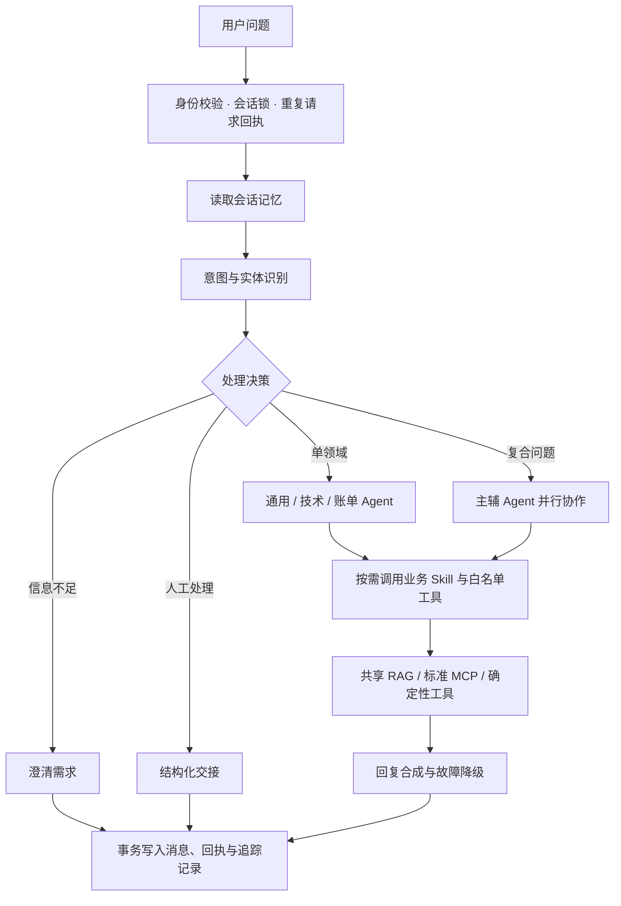

# CasePilot

### 客服问题分诊与协作处理助手

面向 SaaS 客服中“登录异常 + 扣款争议 + 政策咨询”的混合问题，CasePilot 将需求澄清、专业 Agent 协作、知识检索和人工交接串成可追踪的处理流程。

**Python · FastAPI · Redis · ChromaDB · MCP · Prometheus**

项目基于已有客服 Agent 工程进行场景化改造与验证。仓库区分基础实现和后续改造提交，实际能力以代码、测试与回放报告为准。

场景化部分包含订阅分诊 Skill、七类业务验收用例、HTTP 回放与回执一致性检查；完整运维说明独立维护，首页聚焦问题、方案和可运行证据。

## 从一个问题出发

> “我的账号登录一直返回 401，而且同一笔订阅扣了两次 99 元，帮我处理一下。”

CasePilot 提取错误码、金额等实体，识别技术与账单信号，调用主辅 Agent：技术节点整理排障步骤，账单节点核对必要字段，最后合并回复。政策问题可调用 RAG，需要人工核验时生成交接摘要。

演示工具提供字段核验、金额计算与排障建议。真正的退款和工单写入需要业务系统适配器。

## 处理流程



RAG 发生在 Agent 的工具执行阶段。检索工具内部进行查询改写、并行召回、去重和可选重排；三路意图识别指 LLM、向量相似度与规则融合，与多查询召回是两套逻辑。

## 重点能力

| 业务问题 | 实现方式 | 代码入口 |
| --- | --- | --- |
| 一句话包含多个诉求 | 领域识别、主辅路由、并行执行与回复合成 | `agents/agent_orchestrator.py` |
| 回答需要政策依据 | 按需检索共享知识库，工具结果进入模型上下文 | `tooling/knowledge_base.py` |
| 外部工具不稳定 | 超时、TTL 缓存、熔断、恢复探测和回退轨迹 | `tooling/tool_manager.py` |
| 重试产生重复消息 | 会话锁与事务回执，已完成请求返回已有结果 | `core/concurrency.py`、`memory/` |
| 外部数据源扩展 | 官方 MCP SDK、工具白名单和角色范围 | `tooling/mcp_client.py` |
| 改动难以验证 | 单元测试、异步 Judge、业务场景 HTTP 回放 | `tests/`、`evaluation/`、`examples/` |

## 启动与体验

准备 Docker Compose 和支持 Anthropic Messages 工具调用的模型服务：

```bash
cp .env.example .env
# 编辑 .env，填写模型名称、API Key、服务地址和 Redis 密码
docker compose up -d --build
```

Windows 可用 `Copy-Item .env.example .env`。打开 `http://localhost:8000/docs`，执行 `/chat`：

```json
{
  "message": "登录返回401，同一订阅又重复扣了99元，怎么排查？",
  "user_id": "demo-user",
  "client_request_id": "demo-001"
}
```

响应包含 `primary_agent`、`supporting_agents`、`tools_used`、`routing_reason` 和 `request_id`。通过 `/trace/tool/{request_id}` 查看工具执行记录；重复请求必须复用相同的请求 ID、会话和消息。

配置、标准 MCP 接入和部署说明见 [运行手册](OPERATIONS.md)。新版本应用变量以 `CASEPILOT_` 开头，容器和监控指标统一使用 `casepilot` 名称。

## 可回放的业务验收

[演示数据](examples/service_cases.json) 覆盖寒暄、401 排障、扣款、发票、复合诉求、政策检索和人工交接。回放器通过实际 HTTP API 验证结果：

```bash
python examples/replay.py --base-url http://127.0.0.1:8000
# 可选：再发送同一个请求，验证完成回执的一致性
python examples/replay.py --base-url http://127.0.0.1:8000 --check-idempotency
```

回放会真实调用模型，输出各场景的路由与工具断言、失败原因和响应耗时，以及汇总 p50/p95。启用鉴权时，通过运行进程的 `CASEPILOT_API_TOKEN` 环境变量提供用户访问 Token。报告不保存 Token 或响应正文。

检索用例需要先通过管理员 `/knowledge/add` 导入 [示例知识](examples/demo_knowledge.json)。内容均为虚构演示，不代表真实服务承诺。报告保存在忽略提交的 `data/replays/` 中；断言通过只说明用例满足约定，不代表回答质量或线上准确率。

## 验证与阅读入口

```bash
python -m pip install -r requirements.txt
python -m pip install pytest pytest-asyncio
python -m pytest -q
```

- [设计取舍与能力边界](docs/design.md)
- [五分钟演示路径](docs/demo.md)
- [本地验证记录](docs/verification.md)
- [配置、部署与故障排查](OPERATIONS.md)
- [业务规则扩展](skills/README.md)

当前推荐单应用进程部署，知识库为共享库，评测队列与部分运行状态位于进程内。公开版未包含用户数据或密钥，未声称已经过真实线上流量验证。
